# ZCode 项目昵称

在 ZCode 的「项目昵称」面板里区分同名项目，设置昵称、置顶项目，并从本地 Git / SVN 获取名称候选。独立个人插件，无其他插件依赖。

**照常从原来的 ZCode App 图标启动。** 插件通过官方 MCP Apps 侧栏运行，不创建额外 App，不修改应用包、不重新签名，也不需要调试端口或注入脚本。

**功能范围：昵称与置顶只作用于本插件面板，不能同步改变 ZCode 原生左侧项目列表，也不会修改真实目录、聊天或代码。** 当前公开插件接口没有提供原生项目菜单扩展能力。本插件不把这个限制伪装成已经实现的功能。

> **需要「原生左侧项目列表」效果（⋯ 菜单 / 置顶 / 编辑）且保留 Computer Use 的用户：使用 [`sidebar/`](sidebar/README.md) 方案（2026-10-16 深夜实机验证）。** 只改 `app.asar` 追加加载入口，不碰 `Info.plist`、不重签：厂商签名原样保留，签名校验与原始应用逐项一致，Computer Use 实测可用；自带升级后自动补回的 LaunchAgent。面板与侧栏两种效果按需二选一，互不依赖。

## 使用效果

以下图片是 **0.7.0 的真实面板代码**在隔离浏览器中，通过官方 AppBridge 和真实 stdio MCP 服务运行的截图，使用本地测试 Git / SVN 项目，不是原生左侧项目菜单截图。ZCode 内的面板宽度、主题由宿主决定。

### 项目列表与更多菜单

完整路径始终显示，两个都叫 `serverless` 的项目也能区分。项目的「⋯」里有「置顶 / 编辑 / 从面板移除」。

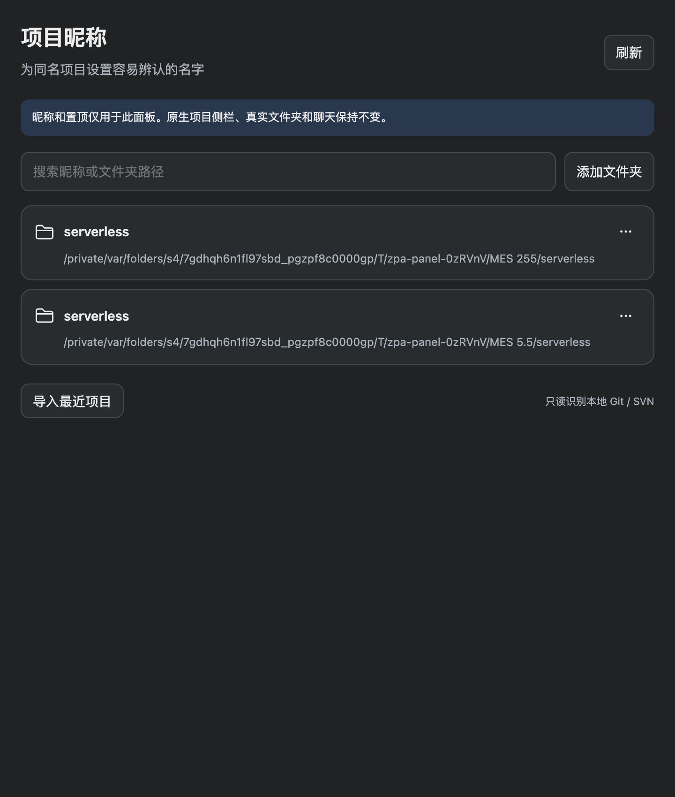
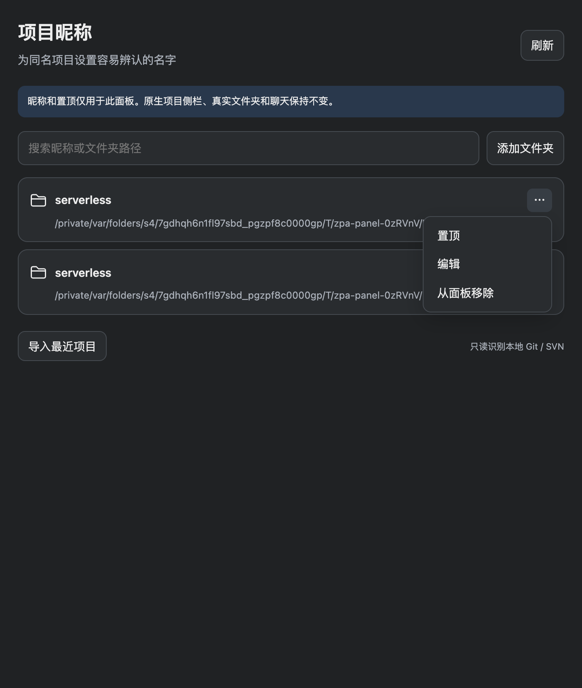

### 编辑昵称与 Git 名称候选

点击「编辑」，输入例如 `MES 255/管理端`。点击候选填入前缀，再补后缀；只有点「保存」才会生效。留空或点「恢复原名」后保存，即恢复文件夹名称。「取消」和 Esc 不保存。

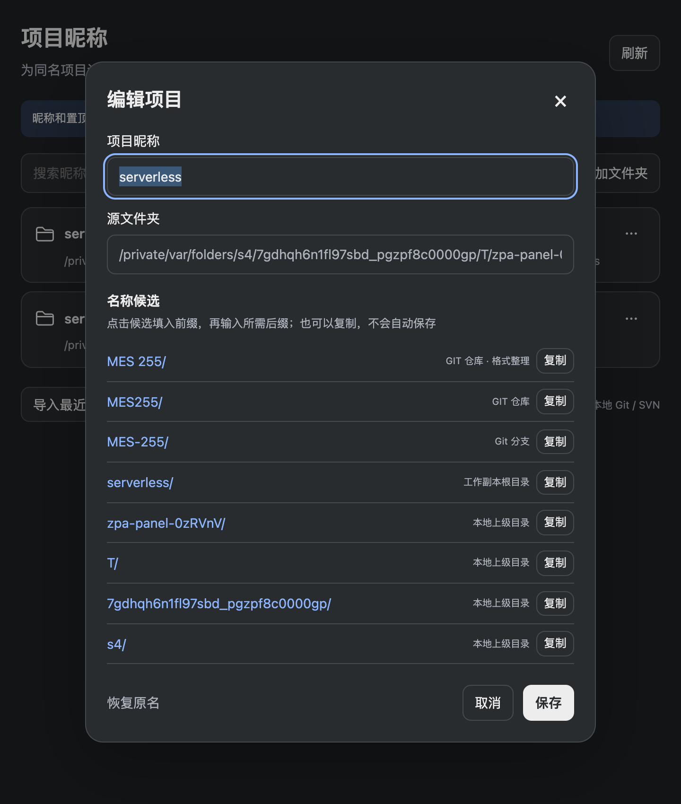
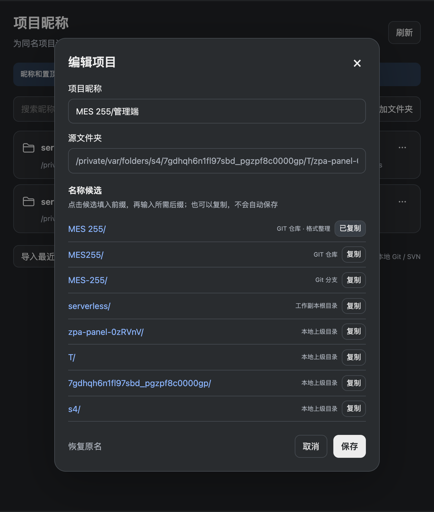

### SVN 名称候选

从本机工作副本的仓库名、路径片段识别候选。Git 同时读取 origin 的路径名称和当前分支；不会显示 URL 中的凭据，不连接远端仓库，不运行拉取、更新或提交。未安装 Git/SVN、目录失效或元数据不可读时，显示原因并尽可能提供本地上级目录候选，仍可手动编辑。

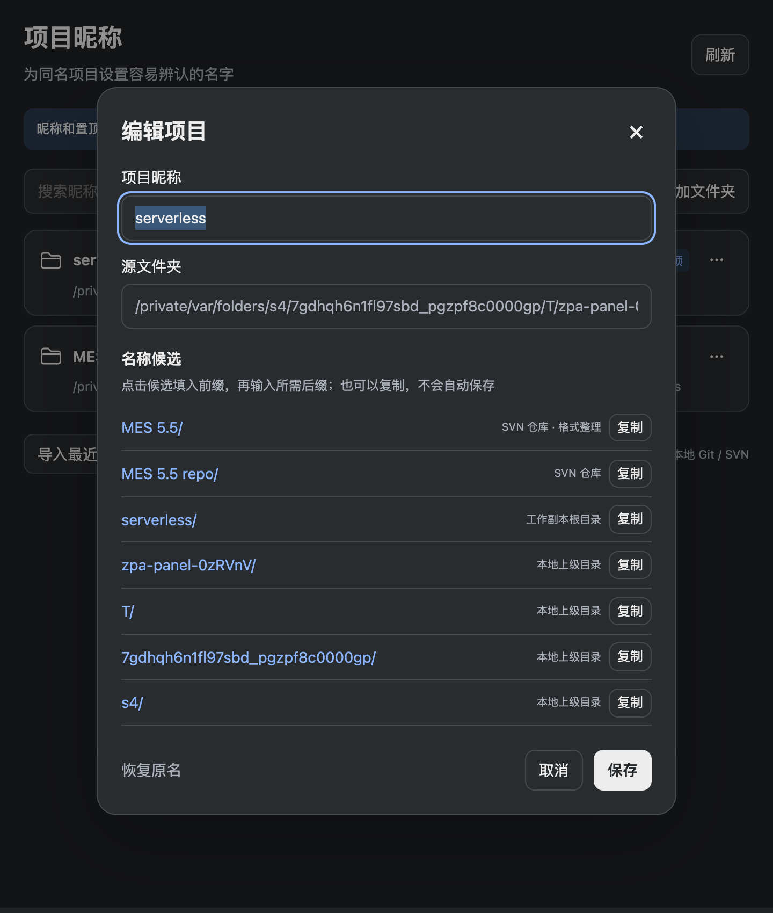

候选支持「复制」。宿主或系统没有授予剪贴板权限时，会显示并选中可手动复制的文本，按 ⌘C（Windows / Linux 按 Ctrl+C）即可；不会谎报复制成功。

### 置顶、搜索和添加

置顶项目排列在面板前面，取消置顶恢复原顺序。可以按昵称或完整路径搜索，也能手动添加本地文件夹。

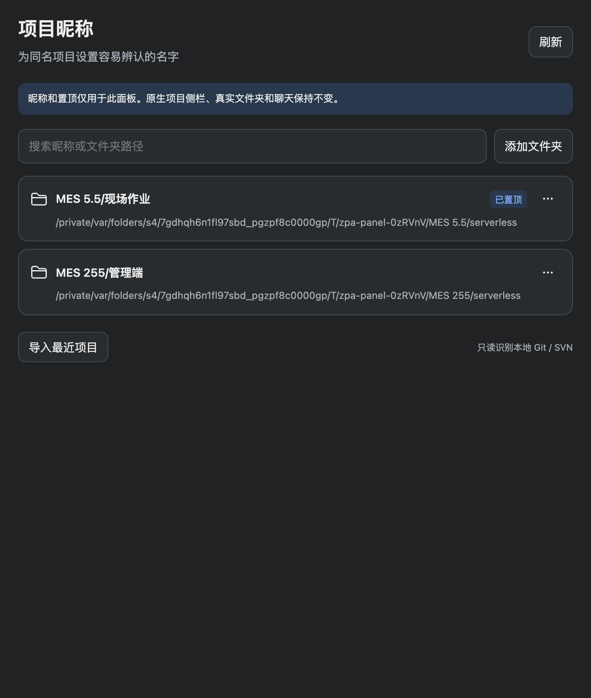
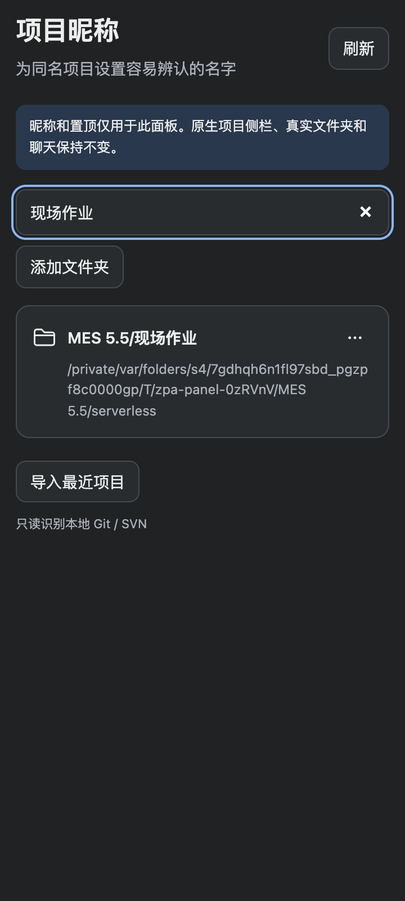
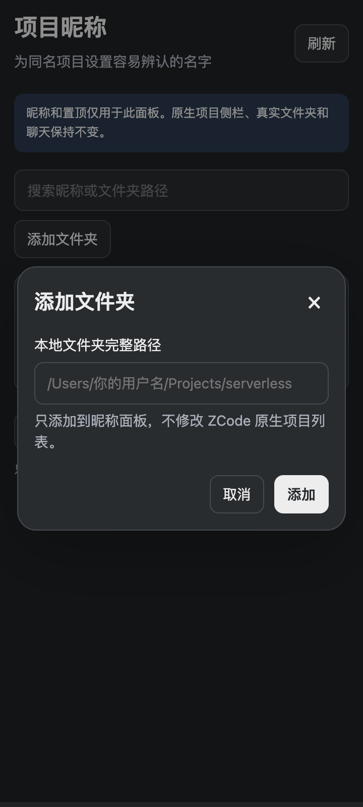

「从面板移除」只隐藏本插件条目，不删除文件、聊天或原生项目；再次添加同一路径会恢复昵称和置顶。「导入最近项目」会读取 ZCode 的最近项目，并恢复其中此前被隐藏的条目。

### 保存失败、浅色与窄面板

保存失败时保留弹窗与输入；不同窗口同时编辑同一项目时拒绝旧版本覆盖，并提示刷新后重新编辑。不同项目可独立保存。

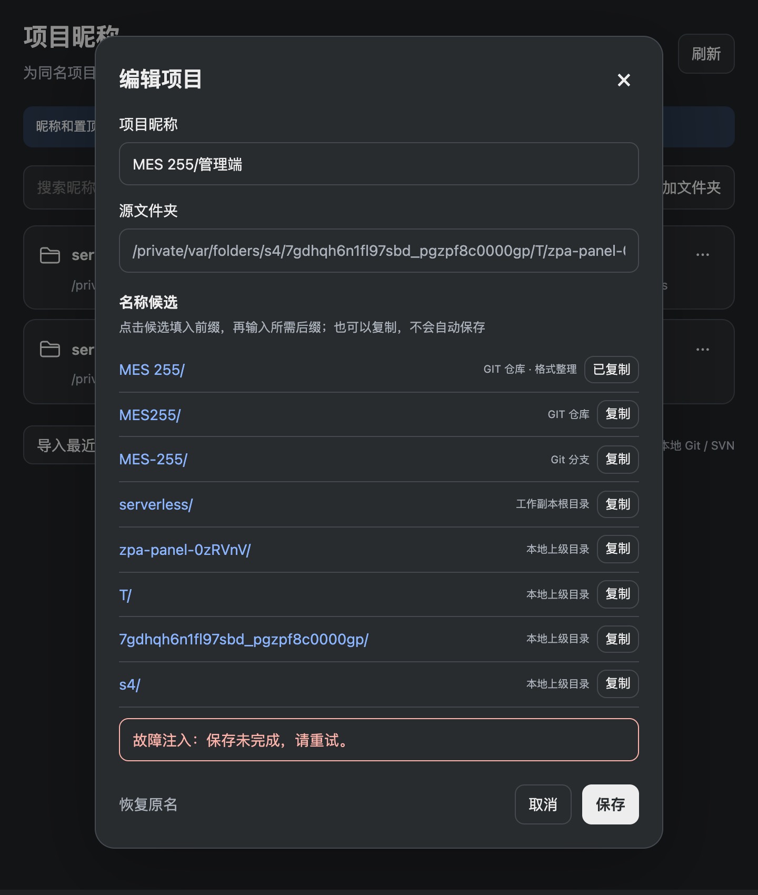
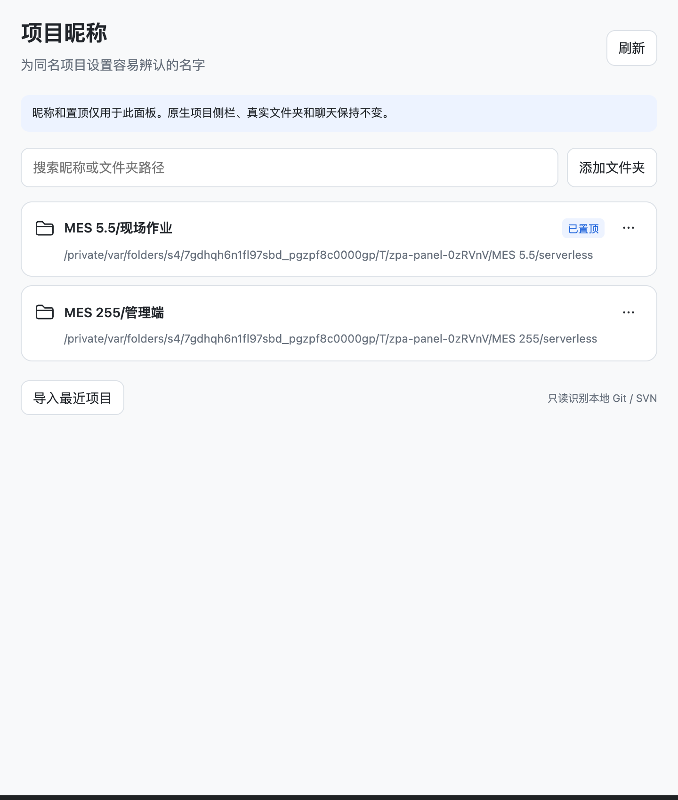
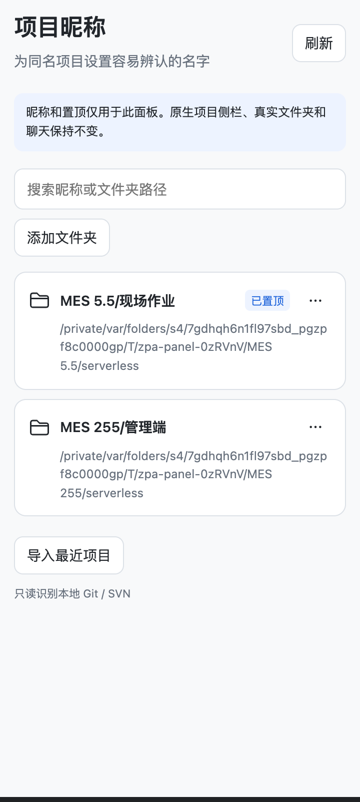

## 安装与打开

需要支持官方 UI Plugin 的 ZCode Desktop，以及可运行 `node` 的本地环境（Node.js 20 或更新）。本机验收目标为 macOS ZCode 3.15.3 / 3.15.3.8237；其他版本和平台尚未实机验收。仅支持本地工作区，远程项目不导入。

1. 在 ZCode「插件市场 → 新增」添加来源 `https://github.com/chenmingye/zcode-project-alias`。
2. 将 `zcode-project-alias` 安装并启用到「个人插件」。已装过则刷新同一来源后更新，保持同一个插件身份。
3. 照常从原版 ZCode 图标启动，打开一个**本地项目的会话**。
4. 点击「展开侧边面板」，选择「项目昵称」。也可在新增标签菜单选择它，或让 AI 调用插件的 `open_project_manager`。

插件未出现在已打开的旧会话时，先新建一个本地会话再试。仍未加载时，在工作保存后正常退出并从**原版图标**重新打开；不承诺所有宿主版本都能热更新插件服务。

已有来源的 CLI 更新示例（使用你已安装的 `zcode` 命令）：

```sh
zcode plugins marketplace update zcode-project-alias-marketplace --scope user
zcode plugins install zcode-project-alias@zcode-project-alias-marketplace --scope user
```

插件安装目录内已包含独立 `dist/server.mjs` 和 `dist/panel.html`，运行不依赖本仓库的 `node_modules`，无须另跑界面安装脚本。

## 数据与限制

- 自动读取 `~/.zcode/v2/setting.json` 中的本地项目路径与当前工作区；「导入最近项目」才额外读取最近项目。只提取路径，不复制模型、账号等配置，不写宿主设置。
- 昵称、置顶、隐藏状态保存在 `~/.zcode/zcode-project-alias/panel/projects.json`，不放进业务项目。设置了 `ZCODE_DATA_BASE_DIR` 时使用该数据根目录，避免与其他配置混用。
- 同名项目按规范化后的绝对路径区分，软链接到同一目录会合并。目录移动后视为另一个项目，不猜测关联，也不修改目录。
- 最多保存 500 个项目；昵称最长 80 字符，不接受换行或控制字符。临时消失的目录仍保留条目与昵称，仓库候选会显示不可用原因。
- 数据写入使用进程间锁、版本检查和原子替换。损坏文件不自动覆盖；保存中断遗留 `write.lock` 时会明确报错，确认插件服务均已退出后才可移除该锁目录。
- 服务随 ZCode 插件会话运行，不注册登录项、LaunchAgent 或独立启动器，不对外提供 HTTP 服务。
- 本插件只管理名称清单，暂不支持点击条目切换原生项目或打开其历史聊天。

卸载时在「个人插件」卸载即可。独立数据文件保留，重新安装可以继续使用。

### 从旧加载器切换

如果本机曾安装需要改应用包或额外启动器的版本，先使用新包中的维护工具停用旧入口、归档旧启动器：

```sh
python3 plugins/zcode-project-alias/scripts/maintenance.py retire-legacy
python3 plugins/zcode-project-alias/scripts/maintenance.py doctor
```

路径应替换为你实际下载或安装的插件目录。维护工具不退出 ZCode、不修改应用包、不重新签名。切换后请在方便时正常退出一次，再从原版图标打开，以结束旧伴随进程。

旧昵称保留在原来的客户端存储中；新沙箱面板不能直接读取它，不承诺自动迁移。维护工具不会清空旧昵称。

若诊断显示厂商签名无效，需要用官方安装包恢复 ZCode，插件安装或卸载不能恢复被替换的官方签名。不要再运行旧的 `install.py`、覆盖 `app.asar` 或 ad-hoc 重签名。

## 开发与验证

```sh
npm ci --no-audit --no-fund
npm run check
npm test
npm run test:panel
npm run screenshots
npm run package
```

源码在 `plugins/zcode-project-alias/src/`，只读仓库候选服务在 `runtime/name-suggestions.cjs`。构建生成独立服务与单文件页面，官方 SDK 和运行依赖随包提供；第三方声明见 `dist/THIRD_PARTY_NOTICES.txt`。

- 单元与协议回归覆盖项目隔离、持久化、置顶顺序、多窗口冲突、路径校验、损坏数据与保存失败，以及仓库外产物的真实 stdio MCP 握手。
- 浏览器回归通过官方 AppBridge，覆盖真实 Git/SVN 候选、昵称编辑/恢复、复制回退、置顶/取消、搜索、添加/移除、冷重建、失败保留输入和窄面板。
- 浏览器夹具不能代替真实 ZCode 宿主与 Computer Use 验收；宿主验收结果和未验证范围应单独说明。

参考：[官方 UI Plugin 文档](https://github.com/zai-org/zcode-plugins/blob/main/UI_PLUGIN.md)、[MCP Apps](https://github.com/modelcontextprotocol/ext-apps)。
