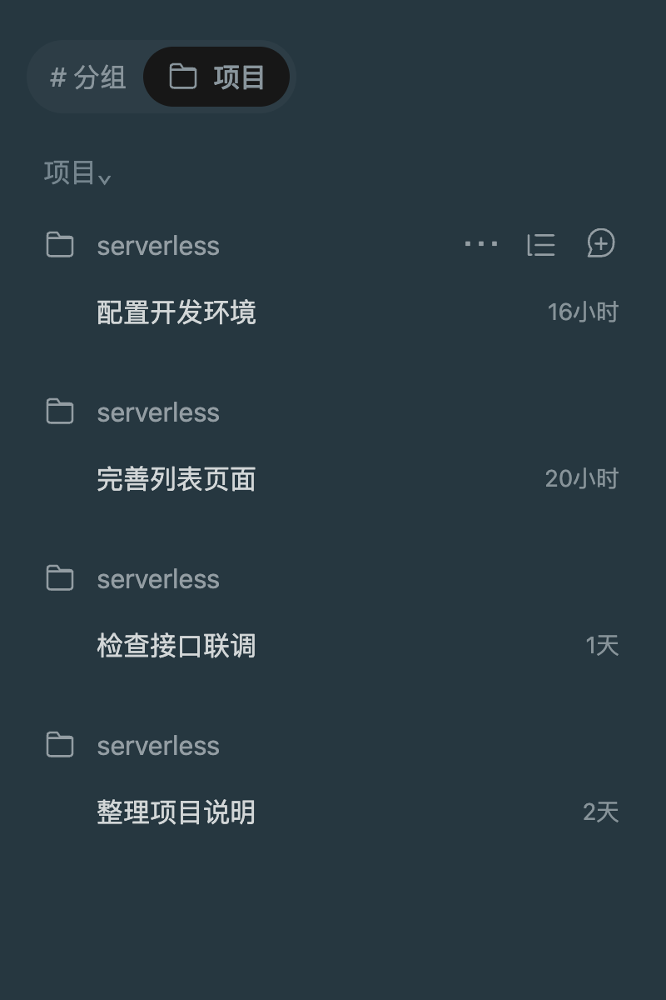

# ZCode 项目昵称

> `0.6.0` 使用外部伴随加载器与匿名调试管道：不修改 ZCode 应用包、不重签名、不开放网络调试端口。安装器会先验证官方完整签名。本机已同时验证昵称功能与 ZCode 自身的 Computer Use：真实应用列表、Finder 可访问性状态和 ZCode 主窗口截图均成功返回。验证目标为 macOS ZCode 3.15.3 / 3.15.3.8237，其他版本需重新验证。

**独立插件，无其他插件依赖。** 左侧项目的“⋯ 更多”菜单提供“置顶 / 编辑 / 移除”，在“编辑项目”弹窗中修改名称。不改真实目录、仓库名称或会话归属。

版本 `0.6.0`。作者：Jason.chen。目前适配 macOS ZCode Desktop 3.15.3 的项目列表结构，其他客户端版本需重新验证。

## 功能效果图

以下为功能演示截图：侧栏按 ZCode 的参考截图搭建，菜单和编辑弹窗运行当前插件代码，项目路径和 SVN / Git 候选使用示例数据。这些不是已安装到真实 ZCode 的实机截图，也不代表真实客户端验收已完成。

### 先悬停项目行，再打开更多菜单

鼠标移到项目行后，右侧显示三个操作按钮。点击第一个 `⋯` 才会打开下方的“置顶 / 编辑 / 移除”菜单。后两个按钮属于 ZCode 原有功能，本插件不替换它们。



### 同名项目，一眼区分

几个目录都叫 `serverless`，可分别设置为 `MES 255/管理端`、`MES 255/现场作业`。只改显示昵称，任务标题和真实路径保留。

| 设置昵称前 | 设置昵称后 |
| --- | --- |
|  |  |

### 更多菜单：置顶 / 编辑 / 移除

点击项目行的“⋯ 更多”，直接选择置顶或编辑；“移除”保留宿主原有行为。


置顶后项目排在当前列表顶部，再次打开菜单可“取消置顶”。图中“现场作业”从第二项移到了第一项。


### 编辑项目：昵称、源文件夹、保存与取消

“编辑”打开弹窗。顶部修改昵称，下方可核对真实源文件夹和完整路径；点击保存生效，取消或关闭不保存。


弹窗适配深色和浅色主题：

| 深色主题 | 浅色主题 |
| --- | --- |
|  |  |

### SVN 候选名称：点击填入，也能复制

从本地 SVN 信息中识别名称前缀。点击 `MES 255/` 后接着输入“管理端”；点击旁边的“复制”可复制同一前缀，按钮显示“已复制”。填入或复制都不会自动保存。


### Git 与目录候选：显示来源

Git 项目可提供 origin 仓库名、当前分支和上级目录候选，每一项都标明来源，方便选择适合自己的命名方式。


### 恢复原名

在编辑弹窗点击“恢复原名”，即可清除该项目昵称；也可以清空输入框后保存。图中“管理端”恢复为 `serverless`，另一个项目的昵称和置顶状态保留。


## 使用

1. 将鼠标移到项目行，点击右侧出现的第一个“⋯ 更多”按钮；后两个按钮仍是宿主原有操作。
2. 点击“置顶”，将项目放到当前列表顶部；已置顶时显示“取消置顶”。多个置顶项目保留宿主原有相对顺序，取消后按宿主当前顺序显示。
3. 点击“编辑”，打开“编辑项目”弹窗，在里面修改名称并保存。
   下方“源文件夹”卡片只读展示真实目录名和完整路径；关闭、取消或按 Escape 均不保存。
4. 留空或点击“恢复原名”可还原；悬停项目行可查看真实路径。

昵称和置顶状态按完整路径与远端身份分别保存到当前客户端 localStorage。同一配置下的窗口间同步，重开客户端仍可恢复。清除应用存储、换配置目录或更换远端身份后可能需要重新设置。当前覆盖左侧“项目”视图，其他标题、分组视图和搜索结果仍由宿主显示原名称。

### 从 SVN / Git 选择名称前缀

“编辑项目”弹窗的“候选名称”会在打开时只读识别本地项目：

- SVN：工作副本的仓库名、URL 路径层级、分支路径和根目录。
- Git：本地配置中的 origin 仓库名、当前分支和根目录，支持 `.git` 文件形式的独立 git-dir。
- 本地上级目录：补充项目所在目录中的名称；没有版本控制或命令不可用时仍可回退。

候选带来源说明。点击 `MES 255/` 会填入名称输入框，将光标留在末尾，可接着输入“管理端”或“现场作业”；旁边的“复制”可复制同一前缀。二者都不会自动保存。晚到的识别结果只更新候选，不覆盖草稿；关闭弹窗后不会把旧项目的结果放入另一个项目。

名称优先保留元数据原文，也提供标注“格式整理”的 `MES + 编号/版本` 写法，例如 `demo-MES5.5` 可给出 `MES 5.5/`。这只是可选的显示名称建议，不改变仓库信息，不根据 `serverless` 猜测“管理端”等业务含义。

只执行本地 `svn info`、`git rev-parse`、`git config --get` 和 `git symbolic-ref`，不连接业务仓库服务器，不拉取、更新、提交或运行项目脚本。命令有超时和输出上限，识别结果短暂缓存 60 秒。不会把 remote URL 中的账号密码带到候选或错误信息中。远程工作区暂不在本机读取仓库信息，仍可手动改名。

## 安装与启动

需要 macOS、Python 3.9+、Node.js，以及官方完整签名的 ZCode Desktop。当前验证目标为 `3.15.3 / 3.15.3.8237`。运行时不需要 npm 安装依赖。

先在插件市场添加本仓库，在“个人插件”中安装 `zcode-project-alias`：

```text
/plugin marketplace add chenmingye/zcode-project-alias
/plugin install zcode-project-alias@zcode-project-alias-marketplace
/project-alias-install
```

市场管理插件版本与命令，实际界面由自己的伴随启动器加载。也可以在本仓库根目录执行：

```bash
python3 plugins/zcode-project-alias/scripts/install.py doctor
python3 plugins/zcode-project-alias/scripts/install.py install
```

安装会创建 `~/Applications/ZCode 项目昵称.app`。**之后请从这个启动器打开 ZCode**，可将它拖入 Dock。它启动的仍是 `/Applications/ZCode.app` 中的官方签名程序，沿用原来的账号、项目与会话数据。直接点击原版 ZCode 图标打开时不会自动附带昵称加载器；再打开昵称启动器即可按提示重新打开。

如果 ZCode 已直接打开，启动器会弹出“稍后 / 重新打开”确认。点击“重新打开”才正常退出并重新打开，不强制结束进程；未确认时返回 `state: prepared`、退出码 `2`，表示尚未激活。AI 会话使用 `install --no-prompt` 只准备文件，避免结束自己的执行环境；用户明确同意正常退出后，可在独立终端执行 `install --restart --no-prompt`。

本机旧补丁造成的厂商签名损坏必须先用官方签名应用包恢复。新安装器会拒绝不满足完整厂商签名的应用，不使用旧备份覆盖，不重签名，不调整签名校验。其他扩展如果继续自动修改应用，同样会破坏这一前提，需要先停用其应用注入。

## 加载方式与文件范围

- 自己的运行目录：`~/.zcode/zcode-project-alias/`。包含 `companion.cjs`、`launch-signed.py`、`alias.js`、`name-suggestions.cjs`、配置、状态与日志；启动器保存在用户的 `~/Applications/` 中。
- 外部 Node 伴随进程以 `--remote-debugging-pipe` 启动原厂 ZCode，通过父子进程继承的匿名管道调用 Chromium CDP。不会开启 TCP 调试端口、Node inspector，或修改 Electron fuses。
- 启动时通过 macOS 的进程责任归属接口，让官方 ZCode 独立承担自身身份，避免继承外部 Node 的身份；接口不可用时停止，不绕过 CUA 的连接方签名检查。无需额外编译工具。
- 只向官方应用资源目录里的主窗口注入自己的界面，不向网页、webview 或其他插件页面注入。
- 本机控制 socket 权限为 `0600`，仅提供状态与刷新，不提供任意 JavaScript、CDP 或文件命令执行接口。
- 界面脚本可热更新；伴随进程与仓库识别服务的代码变化需要从昵称启动器重新打开。原版应用的自重启或升级不会自动继承父进程管道，之后请通过昵称启动器打开。
- 应用关闭后伴随进程结束，不擅自把应用再次拉起。关闭加载器的终端或强杀伴随进程可能使调试管道断开，请通过启动器运行，由它管理进程生命周期。

这是非官方扩展，使用 Chromium 调试能力访问宿主主界面，没有官方项目菜单扩展 API 的兼容保证。ZCode 更新后请重新检查界面结构、厂商签名与 Computer Use。无须关闭任何签名或权限校验。

## 检查与卸载

```bash
python3 plugins/zcode-project-alias/scripts/install.py doctor
```

`signature_verified` 表示官方完整签名与厂商身份通过校验；`responsibility_verified` 表示运行中的 ZCode 承担自身责任身份；`live_verified` 表示当前客户端进程已连通伴随加载器并加载匹配的界面版本，不等于所有功能实测通过。`restart_required` 表示需经昵称启动器重新打开。状态不会把过期文件或其他进程视作当前加载结果。

```bash
python3 plugins/zcode-project-alias/scripts/install.py uninstall
```

卸载停用自己的界面、恢复原名称与列表顺序，并移除自己的启动器；不修改原厂应用，不关闭当前会话，已保存昵称与置顶数据保留。市场命令包可以另外在“个人插件”中卸载。

## 开发与验证

```bash
npm ci --no-audit --no-fund
npm run check
npm test
npm run test:native
python3 scripts/package.py
```

测试覆盖匿名管道消息分帧与 UTF-8、请求匹配、超时与断开错误、目标页面白名单、安装器不修改应用、签名失败停止、运行中准备状态，以及昵称、置顶、菜单、编辑、存储失败、多窗口、恢复和 SVN/Git 本地识别。

`test:native` 在官方签名应用的独立配置中验证真实主窗口加载、停用、重新启用，以及应用资源逐字节不变；不读取用户账号或业务配置。它不代替 Computer Use 实际调用。

浏览器测试使用独立无头 Google Chrome，不连接用户浏览器，默认 `/Applications/Google Chrome.app/Contents/MacOS/Google Chrome`，可用 `CHROME_PATH` 指定。截图脚本 `node scripts/capture-screenshots.mjs` 输出到 `docs/images/`，是隔离测试演示；不能冒充真实客户端验收。

## 资料

- [官方插件开发](https://github.com/zai-org/zcode-plugins/blob/main/docs/PLUGIN_DEVELOPMENT_CN.md)
- [官方 UI Plugin 能力](https://github.com/zai-org/zcode-plugins/blob/main/UI_PLUGIN.md)
- [Electron ASAR 完整性](https://www.electronjs.org/docs/latest/tutorial/asar-integrity)
- [给 ZCode AI 的完整安装任务书](INSTALL-ZCODE-AI.md)
