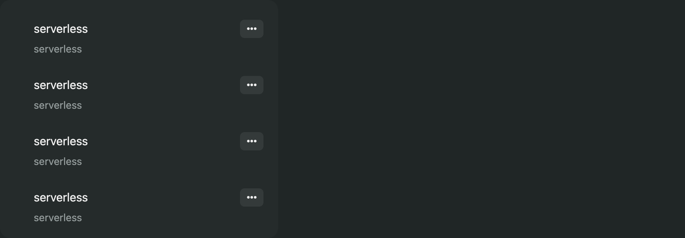
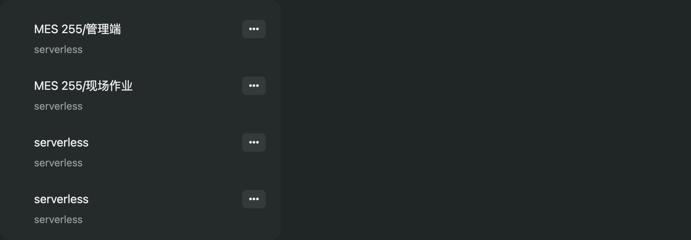
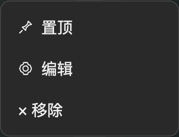
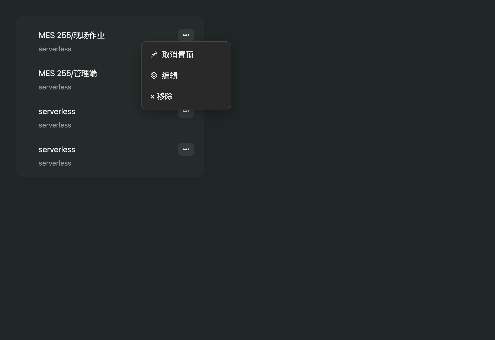
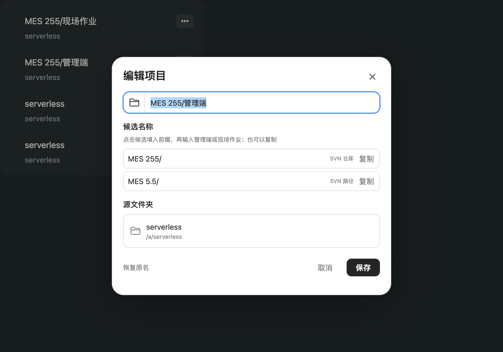
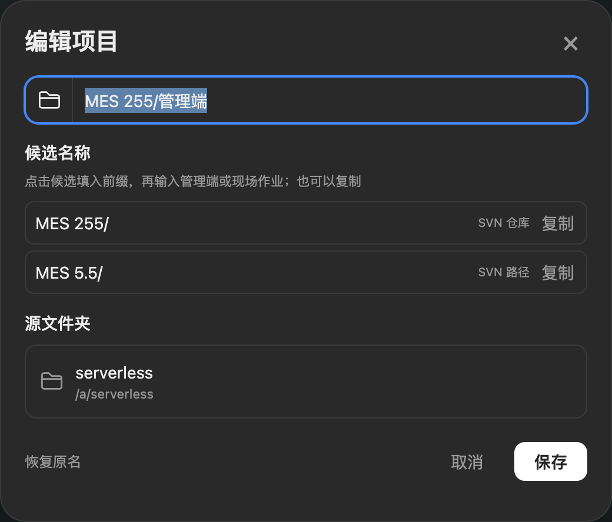
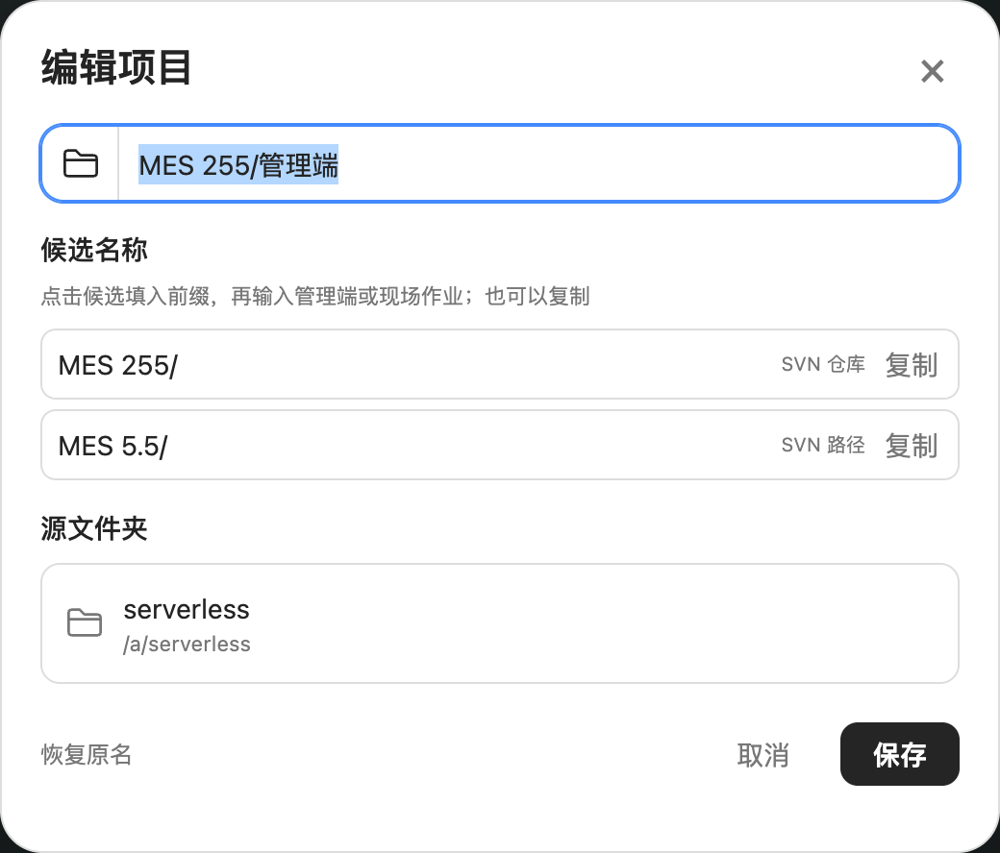
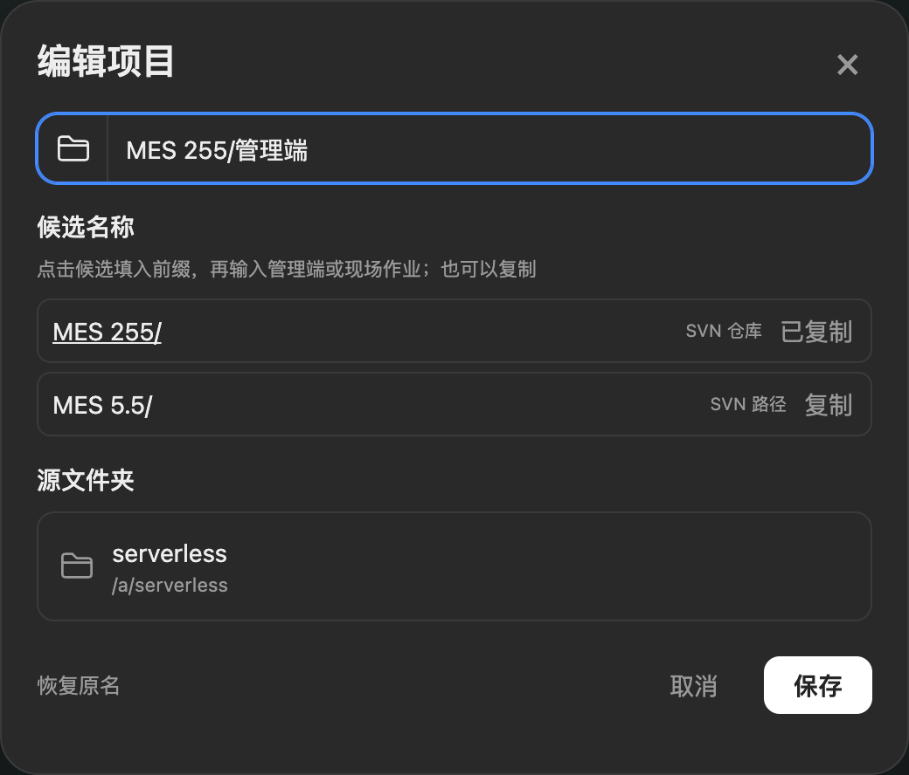
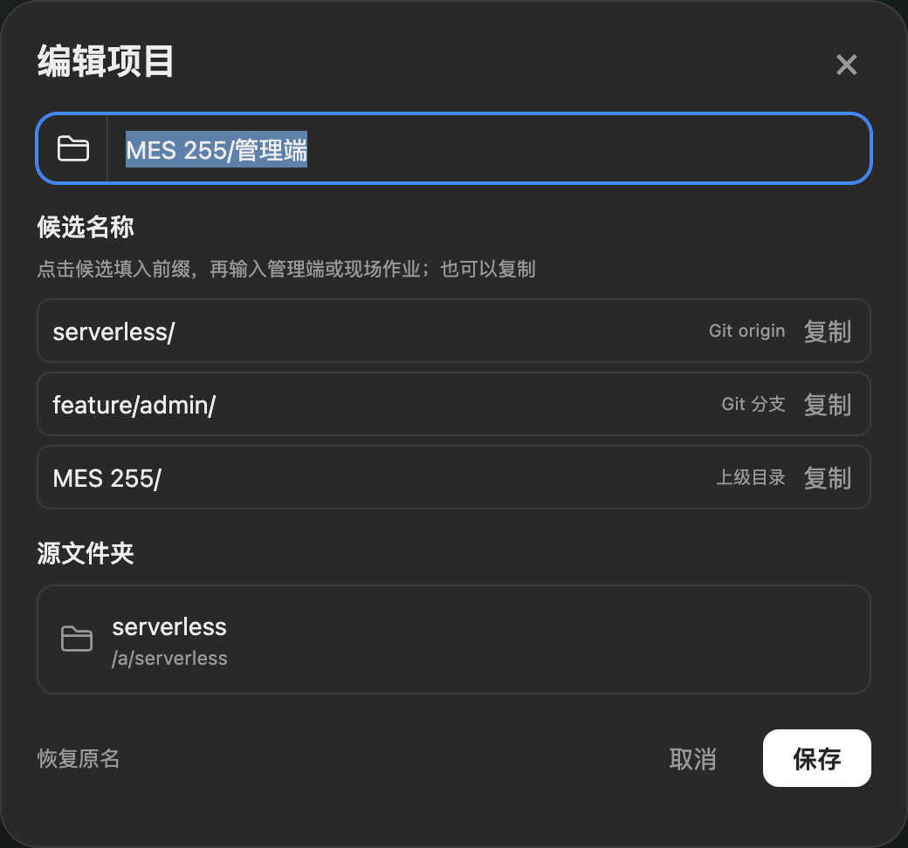
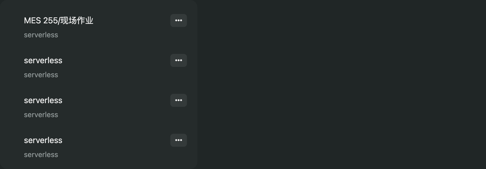

# ZCode 项目昵称

**独立插件，无其他插件依赖。** 左侧项目的“⋯ 更多”菜单提供“置顶 / 编辑 / 移除”，在“编辑项目”弹窗中修改名称。不改真实目录、仓库名称或会话归属。

版本 `0.4.0`。作者：Jason.chen。目前适配 macOS ZCode Desktop 3.15.3 的项目列表结构，其他客户端版本需重新验证。

## 功能效果图

以下图片由当前插件在隔离的 React / Radix 测试界面中实际操作生成，使用示例项目路径与 SVN / Git 候选数据，不是已安装到真实 ZCode 的截图。项目列表背景为测试界面，菜单和编辑弹窗由插件实际渲染；真实客户端效果仍需安装后验收。

### 同名项目，一眼区分

几个目录都叫 `serverless`，可分别设置为 `MES 255/管理端`、`MES 255/现场作业`。只改显示昵称，任务标题和真实路径保留。

| 设置昵称前 | 设置昵称后 |
| --- | --- |
|  |  |

### 更多菜单：置顶 / 编辑 / 移除

点击项目行的“⋯ 更多”，直接选择置顶或编辑；“移除”保留宿主原有行为。



置顶后项目排在当前列表顶部，再次打开菜单可“取消置顶”。图中“现场作业”从第二项移到了第一项。



### 编辑项目：昵称、源文件夹、保存与取消

“编辑”打开弹窗。顶部修改昵称，下方可核对真实源文件夹和完整路径；点击保存生效，取消或关闭不保存。



弹窗适配深色和浅色主题：

| 深色主题 | 浅色主题 |
| --- | --- |
|  |  |

### SVN 候选名称：点击填入，也能复制

从本地 SVN 信息中识别名称前缀。点击 `MES 255/` 后接着输入“管理端”；点击旁边的“复制”可复制同一前缀，按钮显示“已复制”。填入或复制都不会自动保存。



### Git 与目录候选：显示来源

Git 项目可提供 origin 仓库名、当前分支和上级目录候选，每一项都标明来源，方便选择适合自己的命名方式。



### 恢复原名

在编辑弹窗点击“恢复原名”，即可清除该项目昵称；也可以清空输入框后保存。图中“管理端”恢复为 `serverless`，另一个项目的昵称和置顶状态保留。



## 使用

1. 在项目行点击“⋯ 更多”。
2. 点击“置顶”，将项目放到当前列表顶部；已置顶时显示“取消置顶”。多个置顶项目保留宿主原有相对顺序，取消后按宿主当前顺序显示。
3. 点击“编辑”，打开“编辑项目”弹窗，在里面修改名称并保存。
   下方“源文件夹”卡片只读展示真实目录名和完整路径；关闭、取消或按 Escape 均不保存。
4. 留空或点击“恢复原名”可还原；悬停项目行可查看真实路径。

昵称和置顶状态按完整路径与远端身份分别保存到当前客户端 localStorage。同一配置下的窗口间同步，重开客户端仍可恢复。清除应用存储、换配置目录或更换远端身份后可能需要重新设置。当前覆盖左侧“项目”视图，其他标题、分组视图和搜索结果仍由宿主显示原名称。

### 从 SVN / Git 选择名称前缀

“编辑项目”弹窗的“候选名称”会在打开时只读识别本地项目：

- SVN：工作副本的仓库名、URL 路径层级、分支路径和根目录。
- Git：本地配置中的 origin 仓库名、当前分支和根目录，支持 `.git` 文件形式的独立 git-dir。
- 本地上级目录：补充项目所在目录中的名称；没有版本控制或命令不可用时仍可回退。

候选带来源说明。点击 `MES 255/` 会填入名称输入框，将光标留在末尾，可接着输入“管理端”或“现场作业”；旁边的“复制”可复制同一前缀。二者都不会自动保存。晚到的识别结果只更新候选，不覆盖草稿；关闭弹窗后不会把旧项目的结果放入另一个项目。

名称优先保留元数据原文，也提供标注“格式整理”的 `MES + 编号/版本` 写法，例如 `demo-MES5.5` 可给出 `MES 5.5/`。这只是可选的显示名称建议，不改变仓库信息，不根据 `serverless` 猜测“管理端”等业务含义。

只执行本地 `svn info`、`git rev-parse`、`git config --get` 和 `git symbolic-ref`，不连接业务仓库服务器，不拉取、更新、提交或运行项目脚本。命令有超时和输出上限，识别结果短暂缓存 60 秒。不会把 remote URL 中的账号密码带到候选或错误信息中。远程工作区暂不在本机读取仓库信息，仍可手动改名。

## 安装

需要 macOS、Python 3.9+、Node.js 和系统 `codesign`。没有其他插件也能安装、运行和卸载。运行时不需要 npm 安装依赖；仓库的 npm 依赖仅用于开发测试。

将本仓库克隆到本地后，在仓库根目录执行：

```bash
python3 plugins/zcode-project-alias/scripts/install.py doctor
python3 plugins/zcode-project-alias/scripts/install.py install
```

**首次加载独立入口需要正常启动 ZCode。** 若当前 ZCode 正在运行，安装器只准备本插件自己的文件，返回 `state: prepared` 和退出码 `2`，不修改运行中的应用、不退出或重启它。请等长任务完成后自行退出 ZCode，再执行 `install`，成功后正常启动。不能把 `prepared` 当成已经加载。

独立加载器已启动时，重新执行 `install` 可热更新自己的界面脚本；加载器本身变化仍需下次启动。安装器不会刷新窗口、切换任务或发送消息。

本版新增了加载器中的本地仓库读取服务。已有旧版独立加载器的用户也需在方便时正常退出、启动一次；在此之前新界面仍可手动编辑，但仓库候选会提示需要新版加载器。不要为了加载候选中断正在执行的长任务。

### 插件市场

```text
/plugin marketplace add chenmingye/zcode-project-alias
/plugin install zcode-project-alias@zcode-project-alias-marketplace
/project-alias-install
```

市场提供安装/卸载命令。当前会话未发现新命令时可直接运行上面的 Python 命令，不必重载会话。仅安装市场命令包不会自动修改客户端，也不会自动重启。

## 独立加载方式与文件范围

官方 UI Plugin 提供自己的交互面板，已查阅接口没有宿主项目菜单的扩展点，因此本插件使用独立的本地客户端补丁：

- 自己的运行目录：`~/.zcode/zcode-project-alias/`，包含 `loader.cjs`、`alias.js`、`name-suggestions.cjs`、启停配置、状态文件与备份。
- 自己的启动标记：只在 ZCode `app.asar` 的主进程入口追加本加载器的 import，保留原入口其他内容。
- 更新受影响入口与 ASAR 头的 SHA256，并同步 `Info.plist` 完整性记录。应用资源变化后在本机重新建立 ad-hoc 签名，保留现有 entitlements 和硬化运行时 flags；这会替换厂商签名，不代表厂商签名仍然有效。
- 首次修改前备份 ASAR、Info.plist、可执行文件与签名资源；签名失败则回滚本次事务。不关闭 ASAR 校验，不修改 Electron fuses，不移除系统隔离属性，不开启调试端口。
- 不读取或修改任何其他插件的脚本、设置、加载器。自己的加载器只注入 ZCode 主界面，不注入外部网页、webview 或其他本地页面。

这是非官方客户端扩展。ZCode 自身升级可能覆盖启动入口；升级后先运行 doctor，必要时重新安装。项目行结构不兼容时会跳过，不按同名文字猜测项目、不写宿主业务状态。不要把本机修改后的应用包分享给其他人。

## 检查与卸载

`doctor` 只读检查应用、自己的入口与状态。`hook_matches` 表示磁盘入口就绪；`live_verified` 只有匹配当前进程的近期加载器状态确认界面版本后才为 true。最终仍应实际打开项目菜单确认“置顶 / 编辑 / 移除”。

运行中停用界面：

```bash
python3 plugins/zcode-project-alias/scripts/install.py uninstall
```

独立加载器会在约 2 秒内撤销自己的菜单项、恢复原名称和宿主顺序，保留已保存昵称与置顶状态。这个操作不退出 ZCode；自己的启动标记保留为停用状态。市场里禁用命令包不会自动撤销客户端补丁，应先执行本卸载命令。

要完全移除自己的启动入口，等长任务结束并自行退出 ZCode 后执行：

```bash
python3 plugins/zcode-project-alias/scripts/install.py uninstall --remove-hook
```

只移除本插件标记，不拿旧备份整体覆盖后来更新的应用。运行目录和备份仍保留，避免误删昵称和恢复证据。

## 开发与验证

```bash
npm ci --no-audit --no-fund
npm run check
npm test
python3 scripts/package.py
```

浏览器测试使用独立无头 Google Chrome，默认路径 `/Applications/Google Chrome.app/Contents/MacOS/Google Chrome`，可用 `CHROME_PATH` 指定。测试不会连接用户浏览器，不修改本机 ZCode。

测试使用真实 React、Radix portal 菜单，覆盖置顶与取消置顶、编辑改名、原移除操作、键盘、同名项目隔离、远端身份、宿主重排、跨窗口、新文档恢复、取消、存储失败和卸载。独立加载器测试覆盖无其他插件时注入、热更新、停用及页面隔离。安装器在临时应用中验证入口、ASAR 完整性、运行中保护、失败回滚，并在 macOS 上验证临时应用的实际签名。

真实 ZCode 的首次启动与真实远端连接尚待用户在方便时验收；开发过程不会为此中断正在执行的长任务。

README 截图可在安装开发依赖后运行 `node scripts/capture-screenshots.mjs` 重新生成，输出到 `docs/images/`。脚本仅启动本次独立浏览器和临时本地页面，结束后关闭，不操作真实客户端。

## 资料

- [官方插件开发](https://github.com/zai-org/zcode-plugins/blob/main/docs/PLUGIN_DEVELOPMENT_CN.md)
- [官方 UI Plugin 能力](https://github.com/zai-org/zcode-plugins/blob/main/UI_PLUGIN.md)
- [Electron ASAR 完整性](https://www.electronjs.org/docs/latest/tutorial/asar-integrity)
- [给 ZCode AI 的完整安装任务书](INSTALL-ZCODE-AI.md)
